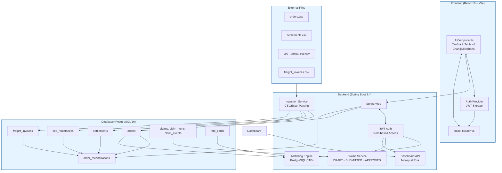

# ReconcileIQ

ReconcileIQ is a modern, high-performance reconciliation engine for D2C brands. It automates the matching of orders against partner settlements, COD remittances, and freight invoices to surface payment shortfalls and overcharged freight.

## Architecture



## ER Diagram

```mermaid
erDiagram
    users ||--o{ claims : "creates"
    orders ||--o{ order_reconciliations : "has"
    orders ||--o{ settlements : "records"
    orders ||--o{ cod_remittances : "tracks"
    orders ||--o{ freight_invoices : "links"
    order_reconciliations ||--o{ claims : "references"
    
    users {
        BIGINT id PK
        VARCHAR email
        VARCHAR password_hash
        VARCHAR role
        VARCHAR full_name
        TIMESTAMP created_at
    }
    
    orders {
        BIGINT id PK
        VARCHAR order_id UK
        VARCHAR channel_code
        DATE order_date
        DECIMAL order_value
        VARCHAR payment_type
        VARCHAR delivery_status
        DECIMAL expected_amount_override
    }
    
    order_reconciliation {
        BIGINT id PK
        VARCHAR order_id UK
        DATE due_date
        DECIMAL expected_settlement
        DECIMAL expected_freight
        DECIMAL received_settlement
        DECIMAL received_freight
        DECIMAL settlement_diff
        DECIMAL freight_diff
        DECIMAL total_tcs
        DECIMAL total_tds
        VARCHAR reconciliation_status
        BOOLEAN is_matched
        TIMESTAMP matched_at
    }
    
    claims {
        BIGINT id PK
        VARCHAR claim_number UK
        VARCHAR partner_code
        VARCHAR partner_type
        DECIMAL total_amount
        VARCHAR status
        VARCHAR created_by FK users.email
        VARCHAR decided_by FK users.email
        TIMESTAMP submitted_at
        TIMESTAMP decided_at
        TEXT decision_notes
    }
    
    claim_items {
        BIGINT id PK
        BIGINT claim_id FK claims
        VARCHAR order_id
        VARCHAR claim_type
        DECIMAL amount
        TEXT evidence_notes
    }
```

## API Summary

### Authentication
| Method | Endpoint | Description |
|--------|----------|-------------|
| POST | `/api/v1/auth/login` | Login with email/password |
| GET | `/api/v1/auth/me` | Get current user |

### Dashboard
| Method | Endpoint | Description | Permissions |
|--------|----------|-------------|-------------|
| GET | `/api/v1/dashboard/summary` | Overall metrics | FINANCE_EXECUTIVE, COFOUNDER |
| GET | `/api/v1/dashboard/money-at-risk` | Money at risk by partner/age | FINANCE_EXECUTIVE, COFOUNDER |

### Orders
| Method | Endpoint | Description | Permissions |
|--------|----------|-------------|-------------|
| GET | `/api/v1/orders` | List orders (paginated) | FINANCE_EXECUTIVE, COFOUNDER |
| GET | `/api/v1/orders/{id}` | Order detail | FINANCE_EXECUTIVE, COFOUNDER |

### Claims
| Method | Endpoint | Description | Permissions |
|--------|----------|-------------|-------------|
| POST | `/api/v1/claims` | Create draft claim | FINANCE_EXECUTIVE |
| POST | `/api/v1/claims/{id}/submit` | Submit claim | FINANCE_EXECUTIVE |
| POST | `/api/v1/claims/{id}/approve` | Approve claim | COFOUNDER |
| POST | `/api/v1/claims/{id}/reject` | Reject claim | COFOUNDER |
| GET | `/api/v1/claims` | List claims | FINANCE_EXECUTIVE, COFOUNDER |
| GET | `/api/v1/claims/{id}` | Claim detail | FINANCE_EXECUTIVE, COFOUNDER |

### Matching
| Method | Endpoint | Description | Permissions |
|--------|----------|-------------|-------------|
| POST | `/api/v1/matching/run` | Run matching | FINANCE_EXECUTIVE |

### Rate Cards
| Method | Endpoint | Description | Permissions |
|--------|----------|-------------|-------------|
| GET | `/api/v1/ratecards` | List all | FINANCE_EXECUTIVE, COFOUNDER |
| PUT | `/api/v1/ratecards/channel/{code}` | Update channel card | FINANCE_EXECUTIVE |
| PUT | `/api/v1/ratecards/courier/{code}` | Update courier card | FINANCE_EXECUTIVE |

## Benchmark Results

| Run | Parse (s) | Load (s) | Match (s) | Total (s) | Mismatches |
|-----|-----------|----------|-----------|-----------|------------|
| 1 | TBD | TBD | TBD | TBD | TBD |
| 2 | TBD | TBD | TBD | TBD | TBD |
| 3 | TBD | TBD | TBD | TBD | TBD |

*Note: Benchmark requires 100k orders uploaded via the ingestion API.*

## Assumptions

See [docs/ASSUMPTIONS.md](docs/ASSUMPTIONS.md) for full details on business rules, tolerance values, tax handling, and role definitions.

## Limitations & Known Issues

### Excluded Features
- User signup/management (demo users only)
- File attachments to claims
- LLM-powered claim suggestions
- Multi-currency support

### Known Issues
- Matching requires all four data sources (orders, settlements, COD, freight)
- Rate card lookup assumes single courier per channel

### Future Improvements
- Bulk claim export/CSV download
- Claim notifications (email/webhook)
- Advanced filtering on claims
- Export reconciliation reports

## Quick Start (Docker)

1. Create `.env` file:
```bash
cat > .env << EOF
JWT_SECRET=your-secret-key-at-least-32-chars-long
DEMO_EXEC_PASSWORD=ExecPassword123!
DEMO_FOUNDER_PASSWORD=FounderPassword123!
EOF
```

2. Build and run:
```bash
docker compose up --build
```

3. Access:
- Frontend: `http://localhost:5173`
- Backend API: `http://localhost:8080`
- Swagger UI: `http://localhost:8080/swagger-ui/index.html`

4. Demo credentials:
- exec@demo.com / ExecPassword123!
- founder@demo.com / FounderPassword123!

## Development

### Backend
```bash
cd backend
mvn spring-boot:run        # Run locally (port 8080)
mvn test                   # Run all tests (51 tests)
```

### Frontend
```bash
cd frontend
npm install
npm run dev                # Run dev server (port 5173)
npm run build              # Production build
npm test                   # Run tests
```

## Documentation

- [Brief](docs/BRIEF.md) - Original requirements
- [Architecture](docs/ARCHITECTURE.md) - System design
- [ASSUMPTIONS.md](docs/ASSUMPTIONS.md) - Business rules and decisions
- [rules.md](docs/rules.md) - Business logic rules
- [deployment.md](deployment.md) - Deployment guide

---
