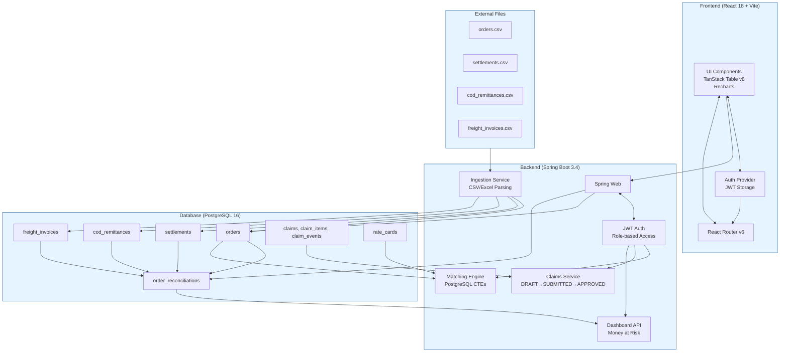
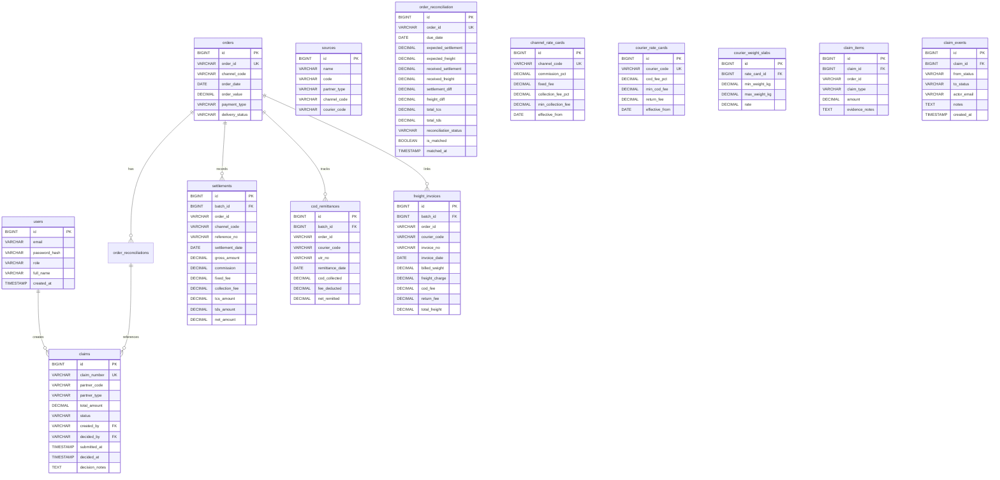

# Technical Design Document

## ReconcileIQ — Payment, Freight & Returns Reconciliation Engine

---

**Version:** 1.0.0  
**Date:** November 2026  
**Author:** Akash (slayer-ak4sh)  
**Repository:** https://github.com/slayer-ak4sh/ReconcileIQ.git  

---

## Table of Contents

1. [Project Overview](#1-project-overview)
2. [Problem Statement](#2-problem-statement)
3. [Objectives and Scope](#3-objectives-and-scope)
4. [Functional Requirements](#4-functional-requirements)
5. [Non-Functional Requirements](#5-non-functional-requirements)
6. [System Architecture](#6-system-architecture)
7. [Architecture Diagram](#7-architecture-diagram)
8. [Technology Stack](#8-technology-stack)
9. [Frontend Architecture](#9-frontend-architecture)
10. [Backend Architecture](#10-backend-architecture)
11. [Database Design](#11-database-design)
12. [API Design](#12-api-design)
13. [CSV Upload and Ingestion Workflow](#13-csv-upload-and-ingestion-workflow)
14. [Column Mapping Workflow](#14-column-mapping-workflow)
15. [Reconciliation and Matching Algorithm](#15-reconciliation-and-matching-algorithm)
16. [Business Rules and Tolerance Handling](#16-business-rules-and-tolerance-handling)
17. [Claims Management Workflow](#17-claims-management-workflow)
18. [Authentication and Authorization](#18-authentication-and-authorization)
19. [Error Handling and Validation](#19-error-handling-and-validation)
20. [Deployment Architecture](#20-deployment-architecture)
21. [Testing Strategy](#21-testing-strategy)
22. [Limitations and Future Enhancements](#22-limitations-and-future-enhancements)

---

## 1. Project Overview

**ReconcileIQ** is a modern, high-performance reconciliation engine designed for D2C (Direct-to-Consumer) brands to automatically ingest partner files (orders, settlements, COD remittances, freight invoices), run order-level matching against rate cards, surface payment shortfalls and unremitted COD, flag overcharged freight, and manage partner claims with audit trails.

The system addresses the critical challenge of financial reconciliation in e-commerce operations where brands sell through multiple channels (Website, Marketplaces, Quick Commerce, Supermarkets) and work with multiple courier partners, each with their own settlement formats, fee structures, and reconciliation cycles.

---

## 2. Problem Statement

D2C brands face significant operational overhead in reconciling payments across multiple channels and courier partners:

- **Multiple Data Sources:** Orders from e-commerce platforms, settlements from payment gateways, COD remittances from couriers, and freight invoices from logistics partners
- **Format Inconsistency:** Each partner provides data in different CSV/Excel formats with varying column headers
- **Complex Fee Structures:** Channel commissions, fixed fees, collection fees, COD fees, weight-based freight slabs, return fees
- **Timing Mismatches:** Settlement cycles vary (T+3 to T+10 days) making it difficult to track what's overdue
- **Lack of Visibility:** No centralized view of money at risk, leakage by partner, or reconciliation status
- **Manual Claim Process:** Identifying and filing claims for shortfalls is time-consuming and error-prone

---

## 3. Objectives and Scope

### Objectives

1. **Automate Ingestion** — Stream CSV/Excel files from multiple partners with deduplication and validation
2. **Normalize Data** — Map varying column headers to canonical fields using versioned mapping profiles
3. **Compute Expected Values** — Calculate expected settlements and freight from database-backed rate cards
4. **Match at Scale** — Set-based PostgreSQL CTE matching for 100k+ orders in under 60 seconds
5. **Surface Discrepancies** — Identify SHORT_PAID, UNPAID_PAST_DUE, FREIGHT_OVERCHARGED with tolerance handling
6. **Track Money at Risk** — Age-bucketed exposure view (0-7, 8-15, 16-30, 31+ days)
7. **Manage Claims** — Full lifecycle DRAFT → SUBMITTED → APPROVED/REJECTED → RECOVERED with evidence
8. **Audit Everything** — Complete audit trail for compliance (DPDP)

### Scope

**In Scope:**
- Orders, Settlements, COD Remittances, Freight Invoices ingestion
- Channel and Courier rate card management
- Order-level reconciliation with status classification
- Dashboard with KPIs, charts, and partner analytics
- Claims workflow with evidence export
- Role-based access control (FINANCE_EXECUTIVE, COFOUNDER)

**Out of Scope:**
- User self-signup/management (demo users only)
- File attachments to claims
- LLM-powered claim suggestions
- Multi-currency support
- Real-time notifications/webhooks

---

## 4. Functional Requirements

### 4.1 File Ingestion
| ID | Requirement | Priority |
|----|-------------|----------|
| FR-01 | Upload CSV/XLSX files for orders, settlements, COD, freight, warehouse scans | P0 |
| FR-02 | SHA-256 file hash deduplication to prevent duplicate uploads | P0 |
| FR-03 | Streaming parsing without loading full file into memory | P0 |
| FR-04 | Row-level validation with rejected row tracking | P0 |
| FR-05 | Batch processing with progress tracking (5,000 row batches) | P0 |

### 4.2 Column Mapping
| ID | Requirement | Priority |
|----|-------------|----------|
| FR-06 | Versioned column mapping profiles per source and file type | P0 |
| FR-07 | Rule-based AI suggestions (Jaro-Winkler + synonym dictionary) | P1 |
| FR-08 | Preview of mapped data before approval | P0 |
| FR-09 | One active version per source/file type; rollback support | P0 |

### 4.3 Rate Card Management
| ID | Requirement | Priority |
|----|-------------|----------|
| FR-10 | Channel rate cards: commission%, fixed fee, collection fee%, min collection fee | P0 |
| FR-11 | Courier rate cards: COD fee%, min COD fee, return fee, weight slabs | P0 |
| FR-12 | Effective-from date support for historical rate changes | P1 |

### 4.4 Reconciliation & Matching
| ID | Requirement | Priority |
|----|-------------|----------|
| FR-13 | Set-based matching via PostgreSQL CTEs joining all data sources | P0 |
| FR-14 | Status classification: SETTLED, SHORT_PAID, UNPAID_PAST_DUE, FREIGHT_OVERCHARGED | P0 |
| FR-15 | Configurable tolerance (default ₹10.00) with boundary rule | P0 |
| FR-16 | Money-at-risk calculation with age bucketing | P0 |
| FR-17 | Review queue for unmatched orders (missing order IDs) | P1 |

### 4.5 Dashboard
| ID | Requirement | Priority |
|----|-------------|----------|
| FR-18 | KPI cards: Total Orders, Money at Risk, Total Leakage, Auto-Match Rate | P0 |
| FR-19 | Money at Risk table by partner with age buckets | P0 |
| FR-20 | Reconciliation status distribution chart | P0 |
| FR-21 | Risk trend chart by age bucket | P0 |
| FR-22 | Financial summary section | P0 |

### 4.6 Claims Management
| ID | Requirement | Priority |
|----|-------------|----------|
| FR-23 | Create draft claims from reconciliation discrepancies | P0 |
| FR-24 | Submit claims (FINANCE_EXECUTIVE) | P0 |
| FR-25 | Approve/Reject claims (COFOUNDER) | P0 |
| FR-26 | Mark recovered (FINANCE_EXECUTIVE) | P0 |
| FR-27 | Evidence CSV export per claim | P0 |
| FR-28 | Claim event audit log | P0 |

---

## 5. Non-Functional Requirements

| Category | Requirement |
|----------|-------------|
| **Performance** | 100k orders processed < 60s; Dashboard loads < 2s |
| **Scalability** | Horizontal scaling via Docker; stateless JWT auth |
| **Security** | JWT HMAC-SHA256; RBAC on all endpoints; PII masking in API responses |
| **Compliance** | DPDP-compliant PII masking (names, phones, addresses) |
| **Reliability** | Idempotent matching runs; Flyway migrations; transaction boundaries |
| **Maintainability** | Package-by-feature; DTO separation; OpenAPI docs; 51+ unit/integration tests |
| **Usability** | Responsive React 18 UI; TanStack Table virtualization; Recharts visualizations |

---

## 6. System Architecture

ReconcileIQ follows a **modular monolith** architecture with clear separation of concerns:

```
┌─────────────────────────────────────────────────────────────────────────────┐
│                              CLIENT (Browser)                               │
│  React 18 + TypeScript + Vite + TanStack Query/Table + Recharts            │
└──────────────────────────────┬──────────────────────────────────────────────┘
                               │ HTTPS / REST API
                               ▼
┌─────────────────────────────────────────────────────────────────────────────┐
│                        BACKEND (Spring Boot 3.4 + Java 21)                 │
│  ┌──────────┐ ┌───────────┐ ┌──────────┐ ┌──────────┐ ┌────────────────┐  │
│  │  Auth    │ │Ingestion  │ │ Mapping  │ │ RateCard │ │   Matching     │  │
│  │ (JWT,    │ │ (CSV/     │ │ (Canon-  │ │ (Channel │ │ (CTE Set-      │  │
│  │  RBAC)   │ │  Excel)   │ │  ical)   │ │  Courier)│ │  Based SQL)    │  │
│  └──────────┘ └───────────┘ └──────────┘ └──────────┘ └────────────────┘  │
│  ┌──────────┐ ┌───────────┐ ┌──────────────────────────────────────────┐  │
│  │ Claims   │ │ Dashboard │ │              Common                       │  │
│  │ (Lifecycle│ │ (Metrics, │ │  (Exception handling, PII masking,       │  │
│  │  + Audit)│ │  Charts)  │ │   Audit logging, Security utils)         │  │
│  └──────────┘ └───────────┘ └──────────────────────────────────────────┘  │
└──────────────────────────────┬──────────────────────────────────────────────┘
                               │ JDBC
                               ▼
┌─────────────────────────────────────────────────────────────────────────────┐
│                      DATABASE (PostgreSQL 16)                               │
│  19 Tables: users, sources, column_mappings, upload_batches, orders,       │
│  settlements, cod_remittances, freight_invoices, returns_scans,            │
│  channel_rate_cards, courier_rate_cards, courier_weight_slabs,             │
│  order_reconciliation, review_queue, claims, claim_items, claim_events,    │
│  audit_log, settings                                                        │
└─────────────────────────────────────────────────────────────────────────────┘
```

---

## 7. Architecture Diagram

### System Overview (Mermaid)



### Entity Relationship Diagram (Mermaid)



---

## 8. Technology Stack

### Backend
| Component | Technology | Version |
|-----------|------------|---------|
| Language | Java | 21 |
| Framework | Spring Boot | 3.4.0 |
| Build Tool | Maven | 3.9+ |
| Web | Spring Web | 3.4.0 |
| Security | Spring Security + JWT | 3.4.0 / 0.12.6 |
| Data Access | Spring Data JPA + JdbcTemplate | 3.4.0 |
| Migration | Flyway | 10.x |
| Validation | Bean Validation | 3.4.0 |
| CSV Parsing | Apache Commons CSV | 1.12.0 |
| Excel Parsing | FastExcel (SAX) | 0.18.0 |
| OpenAPI | springdoc-openapi | 2.7.0 |
| Database | PostgreSQL | 16 |
| Testing | JUnit 5, Mockito, Testcontainers | 5.10+ |

### Frontend
| Component | Technology | Version |
|-----------|------------|---------|
| Language | TypeScript | 5.6.3 |
| Framework | React | 18.3.1 |
| Build Tool | Vite | 5.3.1 |
| State/Query | TanStack Query | 5.51.0 |
| Table | TanStack Table | 8.20.5 |
| Routing | React Router | 6.30.6 |
| Forms | React Hook Form | 7.54.0 |
| Validation | Zod | 3.23.8 |
| Charts | Recharts | 2.12.7 |
| Styling | Tailwind CSS | 3.4.10 |
| Icons | lucide-react | 0.446.0 |
| HTTP Client | Axios | 1.7.7 |
| Testing | Vitest + React Testing Library | 2.1.3 / 14.2.1 |

### DevOps
| Component | Technology |
|-----------|------------|
| Containerization | Multi-stage Dockerfiles |
| Orchestration | Docker Compose |
| CI/CD | GitHub Actions |

---

## 9. Frontend Architecture

### Project Structure
```
frontend/src/
├── api/              # Axios client, interceptors
├── auth/             # AuthProvider, useAuth hook
├── components/       # Reusable UI components
│   ├── Skeleton.tsx
│   ├── Layout.tsx
│   ├── MoneyAtRiskTable.tsx
│   └── StatusBreakdown.tsx
├── hooks/            # Custom React hooks
├── pages/            # Page components
│   ├── Dashboard.tsx
│   ├── Login.tsx
│   ├── Orders.tsx
│   ├── OrderDetail.tsx
│   ├── Claims.tsx
│   ├── Uploads.tsx
│   ├── Mapping.tsx
│   └── RateCards.tsx
├── types/            # TypeScript interfaces
├── utils/            # Formatters, masking, status helpers
├── router.tsx        # React Router config with protected routes
├── main.tsx          # App entry point
└── index.css         # Tailwind + custom styles
```

### Key Design Decisions
1. **TanStack Query** — Server state management with caching, stale-while-revalidate
2. **TanStack Table v8** — Virtualized, sortable, filterable, paginated tables
3. **React Hook Form + Zod** — Type-safe form validation
4. **Recharts** — Declarative SVG charts (Bar, Area) for dashboard visualizations
5. **Tailwind CSS** — Utility-first styling with custom ink/accent color palette
6. **Protected Routes** — Wrapper component checking JWT and role before rendering

### State Management
- **Server State:** TanStack Query (caching, background refetch, deduping)
- **Auth State:** React Context (AuthProvider) with localStorage persistence
- **UI State:** Local component state (useState, useMemo)

### PII Masking
Applied at display layer via utility functions:
- `maskName()` — First letter + asterisks
- `maskPhone()` — Last 4 digits only
- `maskAddress()` — First 3 chars + asterisks

---

## 10. Backend Architecture

### Package-by-Feature Structure
```
com.reconcileiq/
├── auth/           # JWT auth, login, user principal
├── common/         # Exception handling, PII masking, audit log
├── dashboard/      # Summary & money-at-risk endpoints
├── ingestion/      # File upload, CSV/XLSX parsing, batch processing
├── mapping/        # Column mapping CRUD, AI suggestions
├── matching/       # CTE-based reconciliation engine
├── orders/         # Order CRUD, detail view
├── ratecard/       # Channel & courier rate card management
└── claims/         # Claims lifecycle, evidence, events
```

### Core Services

| Service | Responsibility |
|---------|---------------|
| `AuthService` | Login, JWT generation/validation, password encoding |
| `IngestionService` | File upload, parsing, validation, batch persistence |
| `MappingService` | Column mapping CRUD, versioning, suggestions |
| `MatchingService` | CTE-based reconciliation, status computation |
| `ClaimsService` | Claim lifecycle, evidence generation, CSV export |
| `DashboardService` | Aggregated metrics, money-at-risk by partner/age |
| `RateCardService` | Channel/courier rate card CRUD |
| `AuditLogService` | Structured audit trail for all mutations |

### Key Technical Patterns

1. **DTO Separation** — Entities never returned directly; explicit Request/Response DTOs
2. **JdbcTemplate for Bulk** — `batchUpdate` and `COPY` for 5k-row batches
3. **CTE-Based Matching** — Single set-based SQL query joins all sources
4. **@ControllerAdvice** — RFC-7807 error responses: `{timestamp, status, code, message, details}`
5. **@PreAuthorize** — Every endpoint: `hasAuthority('FINANCE_EXECUTIVE')` or `hasAuthority('COFOUNDER')`
6. **Flyway Migrations** — Versioned schema evolution (V1–V11)

---

## 11. Database Design

### Core Tables (19 Total)

| Table | Purpose | Key Columns |
|-------|---------|-------------|
| `users` | Authentication & roles | id, email, password_hash, role (FINANCE_EXECUTIVE/COFOUNDER), full_name |
| `sources` | Sales channels & couriers | id, name, code, partner_type (CHANNEL/COURIER), channel_code, courier_code |
| `column_mappings` | Versioned header mappings | id, source_id, file_type, version, mappings_json, is_active |
| `upload_batches` | File upload tracking | id, source_id, file_type, file_hash, row_count, valid_row_count, status |
| `orders` | Master order feed | id, order_id (UK), channel_code, order_date, order_value, payment_type, delivery_status |
| `settlements` | Channel settlement rows | id, batch_id, order_id, channel_code, reference_no, settlement_date, net_amount, tcs, tds |
| `cod_remittances` | COD remittance rows | id, batch_id, order_id, courier_code, utr_no, remittance_date, net_remitted |
| `freight_invoices` | Courier freight invoices | id, batch_id, order_id, courier_code, invoice_no, billed_weight, total_freight |
| `returns_scans` | Warehouse return scans | id, batch_id, order_id, courier_code, waybill_no, scan_date, condition_status |
| `channel_rate_cards` | Channel fee structures | id, channel_code (UK), commission_pct, fixed_fee, collection_fee_pct, min_collection_fee |
| `courier_rate_cards` | Courier fee structures | id, courier_code (UK), cod_fee_pct, min_cod_fee, return_fee |
| `courier_weight_slabs` | Weight-based freight rates | id, rate_card_id, min_weight_kg, max_weight_kg, rate |
| `order_reconciliation` | Computed reconciliation | id, order_id (UK), due_date, expected/received settlement/freight, diffs, status, is_matched |
| `review_queue` | Unmatched order candidates | id, batch_id, file_type, raw_data_json, suggested_order_id, confidence, status |
| `claims` | Partner claims | id, claim_number (UK), partner_code, partner_type, total_amount, status, created_by |
| `claim_items` | Line items per claim | id, claim_id, order_id, claim_type, amount, evidence_notes |
| `claim_events` | Status transition audit | id, claim_id, from_status, to_status, actor_email, notes, created_at |
| `audit_log` | System-wide audit trail | id, actor_email, action, resource_type, resource_id, details_json |
| `settings` | Configurable parameters | id, setting_key (UK), setting_value, description |

### Performance Indexes
- `idx_orders_order_id` — Order lookup
- `idx_settlements_order` — Settlement aggregation
- `idx_cod_order` — COD aggregation
- `idx_freight_order` — Freight lookup
- `idx_recon_status` — Dashboard filtering
- `idx_recon_due_date` — Age bucketing
- `idx_upload_batches_hash` — Deduplication

---

## 12. API Design

All endpoints under `/api/v1` with JWT Bearer authentication.

### 12.1 Authentication

| Method | Endpoint | Description | Roles |
|--------|----------|-------------|-------|
| POST | `/auth/login` | Email/password → JWT token | Public |
| GET | `/auth/me` | Current user info | Authenticated |

**Login Request:**
```json
{ "email": "exec@demo.com", "password": "ExecPassword123!" }
```

**Login Response:**
```json
{
  "email": "exec@demo.com",
  "fullName": "Finance Executive Demo",
  "token": "eyJhbGciOiJIUzUxMiJ9...",
  "role": "FINANCE_EXECUTIVE"
}
```

### 12.2 Dashboard

| Method | Endpoint | Description | Roles |
|--------|----------|-------------|-------|
| GET | `/dashboard/summary` | KPIs, byStatus counts | FINANCE_EXECUTIVE, COFOUNDER |
| GET | `/dashboard/money-at-risk` | By partner + age buckets | FINANCE_EXECUTIVE, COFOUNDER |

**Summary Response:**
```json
{
  "totalOrders": 15,
  "autoMatched": 15,
  "autoMatchRate": 100.00,
  "moneyAtRisk": 3218.00,
  "totalLeakage": 3218.00,
  "byStatus": { "SETTLED": 3, "SHORT_PAID": 11, "UNPAID_PAST_DUE": 1 },
  "byAgeBucket": { "0to7": 3218.00, "8to15": 0, "16to30": 0, "31plus": 0 }
}
```

### 12.3 Orders

| Method | Endpoint | Description | Roles |
|--------|----------|-------------|-------|
| GET | `/orders` | Paginated, filterable, sortable list | FINANCE_EXECUTIVE, COFOUNDER |
| GET | `/orders/{id}` | Order detail with all linked data | FINANCE_EXECUTIVE, COFOUNDER |

**List Parameters:** page, size, sortBy, sortDir, search, status, channel, paymentType, deliveryStatus

### 12.4 Claims

| Method | Endpoint | Description | Roles |
|--------|----------|-------------|-------|
| POST | `/claims` | Create draft claim from discrepancies | FINANCE_EXECUTIVE |
| POST | `/claims/{id}/submit` | Submit claim for approval | FINANCE_EXECUTIVE |
| POST | `/claims/{id}/approve` | Approve claim | COFOUNDER |
| POST | `/claims/{id}/reject` | Reject claim | COFOUNDER |
| POST | `/claims/{id}/recover` | Mark recovered | FINANCE_EXECUTIVE |
| GET | `/claims` | Paginated list with filters | FINANCE_EXECUTIVE, COFOUNDER |
| GET | `/claims/{id}` | Claim detail with items & events | FINANCE_EXECUTIVE, COFOUNDER |
| GET | `/claims/{id}/evidence.csv` | Download evidence CSV | FINANCE_EXECUTIVE, COFOUNDER |

### 12.5 Matching

| Method | Endpoint | Description | Roles |
|--------|----------|-------------|-------|
| POST | `/matching/run` | Execute reconciliation (idempotent) | FINANCE_EXECUTIVE |

### 12.6 Rate Cards

| Method | Endpoint | Description | Roles |
|--------|----------|-------------|-------|
| GET | `/ratecards` | List all channel & courier cards | FINANCE_EXECUTIVE, COFOUNDER |
| PUT | `/ratecards/channel/{code}` | Update channel rate card | FINANCE_EXECUTIVE |
| PUT | `/ratecards/courier/{code}` | Update courier rate card | FINANCE_EXECUTIVE |

### 12.7 Uploads & Mapping

| Method | Endpoint | Description | Roles |
|--------|----------|-------------|-------|
| POST | `/uploads` | Upload CSV/XLSX file | FINANCE_EXECUTIVE |
| GET | `/uploads` | List upload batches | FINANCE_EXECUTIVE, COFOUNDER |
| GET | `/mapping/sources` | List sources with mappings | FINANCE_EXECUTIVE |
| GET | `/mapping/suggest/{sourceId}/{fileType}` | AI mapping suggestions | FINANCE_EXECUTIVE |
| POST | `/mapping/approve` | Approve mapping version | FINANCE_EXECUTIVE |

### 12.8 Error Response Format

```json
{
  "timestamp": "2026-11-09T13:00:00.000Z",
  "status": 400,
  "code": "VALIDATION_ERROR",
  "message": "Invalid request",
  "details": { "field": "email", "issue": "must not be blank" }
}
```

---

## 13. CSV Upload and Ingestion Workflow

### 13.1 Supported File Types
| File Type | Source | Key Fields |
|-----------|--------|------------|
| ORDERS | Channels | order_id, channel_code, order_date, order_value, payment_type, delivery_status |
| SETTLEMENT | Channels | order_id, reference_no, settlement_date, gross_amount, commission, fees, net_amount |
| COD_REMITTANCE | Couriers | order_id, utr_no, remittance_date, cod_collected, fee_deducted, net_remitted |
| FREIGHT_INVOICE | Couriers | order_id, invoice_no, invoice_date, billed_weight, freight_charge, cod_fee, return_fee |
| WAREHOUSE_SCAN | Couriers | order_id, waybill_no, scan_date, warehouse_location, condition_status |

### 13.2 Ingestion Pipeline

```
Upload Request
      │
      ▼
┌─────────────┐
│ File Hash   │──▶ SHA-256 check ──▶ Duplicate? ──▶ 409 CONFLICT
│ Validation  │
└─────────────┘
      │
      ▼
┌─────────────┐
│ Streaming   │──▶ Apache Commons CSV / FastExcel SAX parser
│ Parser      │     (chunk-by-chunk, no full workbook in memory)
└─────────────┘
      │
      ▼
┌─────────────┐
│ Column      │──▶ Apply active column_mapping for source+file_type
│ Mapping     │     Header → Canonical field
└─────────────┘
      │
      ▼
┌─────────────┐
│ Row         │──▶ Bean Validation @NotNull, @Pattern, custom validators
│ Validation  │     Valid rows → batch insert; Invalid → rejected_rows table
└─────────────┘
      │
      ▼
┌─────────────┐
│ Batch       │──▶ JdbcTemplate.batchUpdate (5,000 rows/batch)
│ Persistence │     or PostgreSQL COPY for maximum throughput
└─────────────┘
      │
      ▼
┌─────────────┐
│ Batch       │──▶ Update upload_batches: row_count, valid_row_count,
│ Completion  │     error_count, status (COMPLETED/FAILED)
└─────────────┘
```

### 13.3 Deduplication
- **File-level:** SHA-256 hash stored in `upload_batches.file_hash`; reject on duplicate
- **Row-level (Settlements):** Dedup by `(reference_no, net_amount, settlement_date)`
- **Row-level (COD):** Dedup by `utr_no`
- **Row-level (Freight):** Latest invoice per order wins

---

## 14. Column Mapping Workflow

### 14.1 Mapping Structure
```json
{
  "mappings": {
    "Order ID": "order_id",
    "Order Date": "order_date",
    "Order Value": "order_value",
    "Channel": "channel_code"
  }
}
```

### 14.2 Workflow Steps
1. **Upload Sample** — User uploads a file without active mapping
2. **Suggest** — `GET /mapping/suggest/{sourceId}/{fileType}` returns AI suggestions
   - Exact match → confidence 1.0
   - Synonym dictionary (e.g., "Order No" → "order_id") → 0.9
   - Jaro-Winkler similarity → 0.5-0.8
3. **Preview** — Response includes `previewRows` showing first 5 rows mapped
4. **Approve** — `POST /mapping/approve` creates new version, marks active
5. **Rollback** — Reactivate prior version (exactly one active per source/file_type)

### 14.3 Mapping Approval
```json
POST /mapping/approve
{
  "sourceId": 1,
  "fileType": "ORDERS",
  "mappings": { "Order ID": "order_id", "Date": "order_date" },
  "createdBy": "exec@demo.com"
}
```

---

## 15. Reconciliation and Matching Algorithm

### 15.1 Execution Flow

```
POST /api/v1/matching/run
      │
      ▼
┌─────────────────────────────────────┐
│ 1. Load Active Rate Cards           │
│    - Channel: by channel_code       │
│    - Courier: by courier_code       │
└─────────────────────────────────────┘
      │
      ▼
┌─────────────────────────────────────┐
│ 2. Aggregate Received Amounts       │
│    - received_settlement:           │
│      SUM(net_amount) from settlements│
│      GROUP BY order_id (deduped)    │
│    - received_cod:                  │
│      SUM(net_remitted) from cod     │
│      GROUP BY order_id (deduped)    │
│    - received_freight:              │
│      Latest total_freight from      │
│      freight_invoices per order_id  │
└─────────────────────────────────────┘
      │
      ▼
┌─────────────────────────────────────┐
│ 3. Compute Expected Amounts         │
│    - expected_settlement:           │
│      order_value * (1 - commission%)│
│      - fixed_fee                    │
│      - max(order_value * coll_fee%, │
│        min_collection_fee)          │
│      (negative for returns)         │
│    - expected_freight:              │
│      weight_slab_rate(billed_weight)│
│      + (COD ? cod_fee : 0)          │
│      + (RETURNED ? return_fee : 0)  │
└─────────────────────────────────────┘
      │
      ▼
┌─────────────────────────────────────┐
│ 4. Calculate Differences            │
│    settlement_diff = received -     │
│      expected_settlement            │
│    freight_diff = received_freight -│
│      expected_freight               │
└─────────────────────────────────────┘
      │
      ▼
┌─────────────────────────────────────┐
│ 5. Apply Status Precedence          │
│    (see Business Rules section)     │
└─────────────────────────────────────┘
      │
      ▼
┌─────────────────────────────────────┐
│ 6. Upsert order_reconciliation      │
│    INSERT ... ON CONFLICT DO UPDATE │
│    Update matched_at only on change │
└─────────────────────────────────────┘
      │
      ▼
┌─────────────────────────────────────┐
│ 7. Populate Review Queue            │
│    Orders in feeds without match    │
│    (missing order_id in orders)     │
└─────────────────────────────────────┘
```

### 15.2 Set-Based CTE Approach

The matching runs as a single PostgreSQL query using CTEs:

```sql
WITH 
rate_cards AS (SELECT ... FROM channel_rate_cards ...),
settlements_agg AS (
  SELECT order_id, SUM(net_amount) AS received_settlement
  FROM settlements
  WHERE ... -- dedup logic
  GROUP BY order_id
),
cod_agg AS (
  SELECT order_id, SUM(net_remitted) AS received_cod
  FROM cod_remittances
  WHERE ... -- dedup logic
  GROUP BY order_id
),
freight_latest AS (
  SELECT DISTINCT ON (order_id) order_id, total_freight AS received_freight
  FROM freight_invoices
  ORDER BY order_id, invoice_date DESC
),
expected AS (
  SELECT o.order_id,
         o.order_value,
         o.payment_type,
         o.delivery_status,
         o.order_date,
         rc.commission_pct,
         rc.fixed_fee,
         rc.collection_fee_pct,
         rc.min_collection_fee,
         -- compute expected_settlement, expected_freight
  FROM orders o
  JOIN rate_cards rc ON o.channel_code = rc.channel_code
  LEFT JOIN courier_rate_cards crc ON ...
  LEFT JOIN courier_weight_slabs cws ON ...
),
final AS (
  SELECT e.order_id,
         e.expected_settlement,
         COALESCE(s.received_settlement, 0) AS received_settlement,
         COALESCE(f.received_freight, 0) AS received_freight,
         e.expected_settlement - COALESCE(s.received_settlement, 0) AS settlement_diff,
         e.expected_freight - COALESCE(f.received_freight, 0) AS freight_diff,
         -- status computation
  FROM expected e
  LEFT JOIN settlements_agg s ON e.order_id = s.order_id
  LEFT JOIN freight_latest f ON e.order_id = f.order_id
)
INSERT INTO order_reconciliation ...
ON CONFLICT (order_id) DO UPDATE SET ...
```

---

## 16. Business Rules and Tolerance Handling

### 16.1 Tolerance
- **Default:** ₹10.00 (configurable via `settings` table)
- **Boundary:** `|difference| == 10.00` → within tolerance (SETTLED)
- **Boundary:** `|difference| >= 10.01` → flag (SHORT_PAID/FREIGHT_OVERCHARGED)
- **Rounding:** Half-up, 2 decimals

### 16.2 Status Precedence (Strict Order)

| Priority | Status | Condition |
|----------|--------|-----------|
| 1 | **UNPAID_PAST_DUE** | `received_settlement == 0` AND `today > due_date` |
| 2 | **SHORT_PAID** | `|diff| > tolerance` AND `received < expected` |
| 3 | **FREIGHT_OVERCHARGED** | `|freight_diff| > tolerance` AND `received_freight > expected_freight` |
| 4 | **SETTLED** | All other cases where `|diff| <= tolerance` |

### 16.3 Money at Risk Calculation
```
Money at Risk = expected_settlement - received_settlement
(only if positive AND status IN (SHORT_PAID, UNPAID_PAST_DUE))
```
- Freight overcharge is **not** included in money at risk
- Reported separately as claimable overcharge
- An order is never double-counted (precedence ensures one classification)

### 16.4 Due Date & Age Buckets
```
Due Date = delivery_date + settlement_window_days
```
| Payment Type | Window |
|--------------|--------|
| COD | T+7 |
| Marketplace Prepaid | T+10 |
| Website Prepaid | T+10 |
| Quick Commerce | T+3 |

**Age Buckets:** 0-7, 8-15, 16-30, 31+ days past due

### 16.5 TCS/TDS Handling
- Excluded from leakage calculations
- Shown in separate tax panel
- `net_leakage = expected_settlement - received_settlement`
- `tax_deducted = SUM(tcs_amount + tds_amount)`

### 16.6 Worked Examples

| Scenario | Expected | Received | Diff | Status | Money at Risk |
|----------|----------|----------|------|--------|---------------|
| Nothing received, past due | 1,379.06 | 0 | -1,379.06 | UNPAID_PAST_DUE | 1,379.06 |
| Short payment | 1,000.00 | 950.00 | -50.00 | SHORT_PAID | 50.00 |
| Exact within tolerance | 1,000.00 | 990.00 | -10.00 | SETTLED | 0 |
| Freight overcharged | 100.00 | 150.00 | +50.00 | FREIGHT_OVERCHARGED | 0 |
| Return over-clawback | -96.00 | -142.00 | -46.00 | FREIGHT_OVERCHARGED | 0 |

---

## 17. Claims Management Workflow

### 17.1 Claim Lifecycle
```
DRAFT ──(FINANCE_EXECUTIVE: submit)──▶ SUBMITTED
                                           │
                    ┌──────────────────────┴──────────────────────┐
                    ▼                                             ▼
             COFOUNDER: approve                              COFOUNDER: reject
                    │                                             │
                    ▼                                             ▼
               APPROVED                                        REJECTED
                    │                                             │
                    ▼                                             │
          FINANCE_EXECUTIVE: recover                            │
                    │                                             │
                    ▼                                             │
               RECOVERED ◀───────────────────────────────────────┘
```

### 17.2 Claim Types
| Type | Source | Description |
|------|--------|-------------|
| SHORT_PAYMENT | Reconciliation | Settlement shortfall (SHORT_PAID) |
| UNREMITTED_COD | Reconciliation | No COD remitted (UNPAID_PAST_DUE) |
| FREIGHT_OVERCHARGE | Reconciliation | Freight overcharged (FREIGHT_OVERCHARGED) |
| LOST_RETURN | Warehouse Scan | Return not received at warehouse |

### 17.3 Evidence Package
Each claim includes:
- `claim_items` with order_id, claim_type, amount, evidence_notes
- Auto-generated from reconciliation discrepancies
- Exportable as CSV via `GET /claims/{id}/evidence.csv`

### 17.4 Audit Trail
- `claim_events` table records every transition: from_status → to_status, actor, timestamp, notes
- `audit_log` records claim creation, submission, decision
- Immutable; no delete operations allowed

---

## 18. Authentication and Authorization

### 18.1 JWT Authentication
- **Algorithm:** HMAC-SHA256 (HS512)
- **Claims:** `sub` (email), `role` (FINANCE_EXECUTIVE/COFOUNDER), `fullName`, `iat`, `exp`
- **Expiry:** 24 hours (configurable)
- **Storage:** HttpOnly cookie alternative; localStorage in current impl

### 18.2 Role-Based Access Control

| Endpoint | FINANCE_EXECUTIVE | COFOUNDER |
|----------|-------------------|-----------|
| Dashboard | ✅ | ✅ |
| Orders | ✅ | ✅ |
| Matching (run) | ✅ | ❌ |
| Rate Cards (read) | ✅ | ✅ |
| Rate Cards (write) | ✅ | ❌ |
| Uploads | ✅ | ❌ |
| Mapping | ✅ | ❌ |
| Claims (create) | ✅ | ❌ |
| Claims (submit) | ✅ | ❌ |
| Claims (approve/reject) | ❌ | ✅ |
| Claims (recover) | ✅ | ❌ |
| Claims (read) | ✅ | ✅ |

### 18.3 Implementation
```java
@PreAuthorize("hasAuthority('FINANCE_EXECUTIVE') or hasAuthority('COFOUNDER')")
@GetMapping("/dashboard/summary")
public Map<String, Object> getSummary(...) { ... }

@PreAuthorize("hasAuthority('FINANCE_EXECUTIVE')")
@PostMapping("/matching/run")
public void runMatching() { ... }

@PreAuthorize("hasAuthority('COFOUNDER')")
@PostMapping("/claims/{id}/approve")
public void approveClaim(...) { ... }
```

### 18.4 Demo Users (Seeded)
| Email | Password | Role |
|-------|----------|------|
| exec@demo.com | ExecPassword123! | FINANCE_EXECUTIVE |
| founder@demo.com | FounderPassword123! | COFOUNDER |

---

## 19. Error Handling and Validation

### 19.1 Global Exception Handler
```java
@ControllerAdvice
public class GlobalExceptionHandler {
    
    @ExceptionHandler(ValidationException.class)
    public ResponseEntity<ErrorResponse> handleValidation(...) { ... }
    
    @ExceptionHandler(AccessDeniedException.class)
    public ResponseEntity<ErrorResponse> handleAccessDenied(...) { ... }
    
    @ExceptionHandler(EntityNotFoundException.class)
    public ResponseEntity<ErrorResponse> handleNotFound(...) { ... }
    
    @ExceptionHandler(Exception.class)
    public ResponseEntity<ErrorResponse> handleGeneric(...) { ... }
}
```

### 19.2 Error Response Format (RFC-7807 Style)
```json
{
  "timestamp": "2026-11-09T13:00:00.000Z",
  "status": 400,
  "code": "VALIDATION_ERROR",
  "message": "Invalid request payload",
  "details": {
    "fieldErrors": [
      { "field": "email", "message": "must not be blank" },
      { "field": "password", "message": "size must be between 8 and 100" }
    ]
  }
}
```

### 19.3 Validation Layers
1. **Controller:** `@Valid` on DTOs + Bean Validation annotations
2. **Service:** Business rule validation (duplicate checks, referential integrity)
3. **Database:** Constraints (UNIQUE, FK, NOT NULL, CHECK)

### 19.4 Upload Security
- File extension allowlist: `.csv`, `.xlsx`
- MIME type verification
- Size limit: 50MB (configurable)
- SHA-256 hash for deduplication
- Parameterized queries (no SQL injection)

---

## 20. Deployment Architecture

### 20.1 Docker Compose Services

```yaml
services:
  postgres:
    image: postgres:16-alpine
    container_name: reconcileiq-postgres
    ports: ["5432:5432"]
    environment:
      POSTGRES_DB: reconcileiq
      POSTGRES_USER: reconcileiq
      POSTGRES_PASSWORD: reconcileiq_secret
    volumes: [postgres_data:/var/lib/postgresql/data]
    healthcheck: pg_isready

  backend:
    build: ./backend
    container_name: reconcileiq-backend
    ports: ["8080:8080"]
    env_file: .env
    environment:
      SPRING_DATASOURCE_URL: jdbc:postgresql://postgres:5432/reconcileiq
      JWT_SECRET: ${JWT_SECRET}
      CORS_ALLOWED_ORIGINS: ${CORS_ALLOWED_ORIGINS}
    depends_on:
      postgres:
        condition: service_healthy

  frontend:
    build: ./frontend
    container_name: reconcileiq-frontend
    ports: ["5173:80"]
    environment:
      VITE_API_BASE_URL: ${VITE_API_BASE_URL:-http://localhost:8080/api/v1}
    depends_on: [backend]
```

### 20.2 Container Details

**Backend Dockerfile (Multi-stage):**
```dockerfile
FROM maven:3.9-eclipse-temurin-21 AS build
WORKDIR /app
COPY pom.xml .
COPY src ./src
RUN mvn clean package -DskipTests

FROM eclipse-temurin:21-jre-alpine
WORKDIR /app
COPY --from=build /app/target/*.jar app.jar
EXPOSE 8080
ENTRYPOINT ["java","-jar","app.jar"]
```

**Frontend Dockerfile (Multi-stage):**
```dockerfile
FROM node:20-alpine AS build
WORKDIR /app
COPY package*.json ./
RUN npm ci
COPY . .
RUN npm run build

FROM nginx:alpine
COPY --from=build /app/dist /usr/share/nginx/html
COPY nginx.conf /etc/nginx/conf.d/default.conf
EXPOSE 80
CMD ["nginx", "-g", "daemon off;"]
```

### 20.3 Nginx Configuration
```nginx
server {
    listen 80;
    root /usr/share/nginx/html;
    index index.html;
    
    location / {
        try_files $uri $uri/ /index.html;
    }
    
    location /api/ {
        proxy_pass http://backend:8080;
        proxy_set_header Host $host;
        proxy_set_header X-Real-IP $remote_addr;
    }
}
```

### 20.4 Network
- All services on shared Docker network
- Backend accessible at `http://backend:8080` internally
- Frontend proxies `/api/` to backend

---

## 21. Testing Strategy

### 21.1 Backend Tests (51 tests)
| Test Type | Framework | Coverage |
|-----------|-----------|----------|
| Unit Tests | JUnit 5 + Mockito | Services, Rules, Mapping |
| Integration Tests | Spring Boot Test + Testcontainers (PostgreSQL) | Controllers, Repositories |
| Matching Answer Key | JUnit 5 | 3 golden test cases (exact match to brief) |

**Key Test Classes:**
- `MatchingRulesTest` — Status precedence, tolerance, money at risk
- `MatchingAnswerKeyTest` — 3 brief scenarios verified
- `IngestionServiceTest` — CSV parsing, validation, dedup
- `MappingServiceTest` — Suggestion engine, versioning
- `ClaimsServiceTest` — Lifecycle, evidence, CSV export
- `AuthControllerTest` — Login, JWT, 401 handling
- `DashboardControllerTest` — Metrics aggregation

### 21.2 Frontend Tests
| Test Type | Framework | Coverage |
|-----------|-----------|----------|
| Unit Tests | Vitest + React Testing Library | Components, hooks, utils |
| Integration | Vitest | API client, auth flow |

### 21.3 Running Tests
```bash
# Backend
cd backend && mvn test

# Frontend
cd frontend && npm test
```

---

## 22. Limitations and Future Enhancements

### 22.1 Current Limitations

| Area | Limitation |
|------|------------|
| User Management | No self-signup; only 2 seeded demo users |
| Claims Attachments | No file upload support for claim evidence |
| AI/ML | Column mapping suggestions only (rule-based); no LLM integration |
| Currency | INR only; no multi-currency or FX conversion |
| Notifications | No email/webhook notifications for claim events |
| Bulk Operations | No bulk claim export or batch claim creation |
| Returns | WAREHOUSE_SCAN ingestion exists but "Return Not Received" status not fully implemented |
| Rate Card Coupling | Assumes single courier per channel; no multi-courier routing |

### 22.2 Future Enhancements

| Priority | Enhancement |
|----------|-------------|
| P1 | Bulk claim export / CSV download |
| P1 | Claim notifications (email/webhook) |
| P1 | Advanced filtering on claims list |
| P1 | Export reconciliation reports (PDF/Excel) |
| P2 | User management (signup, invite, password reset) |
| P2 | File attachments to claims |
| P2 | LLM-powered claim amount suggestions |
| P2 | Multi-currency support with FX rates |
| P3 | Real-time dashboard updates (WebSocket) |
| P3 | Partner portal for self-service claims |
| P3 | Automated matching re-run scheduler |

---

## Appendix: GitHub Repository

**Repository URL:** https://github.com/slayer-ak4sh/ReconcileIQ.git

**Clone Command:**
```bash
git clone https://github.com/slayer-ak4sh/ReconcileIQ.git
cd ReconcileIQ
```

---

*Document generated for ReconcileIQ project submission*  
*🤖 Generated with [Claude Code](https://claude.com/claude-code)*